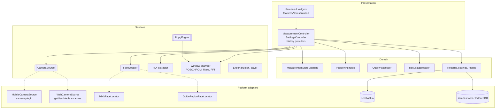
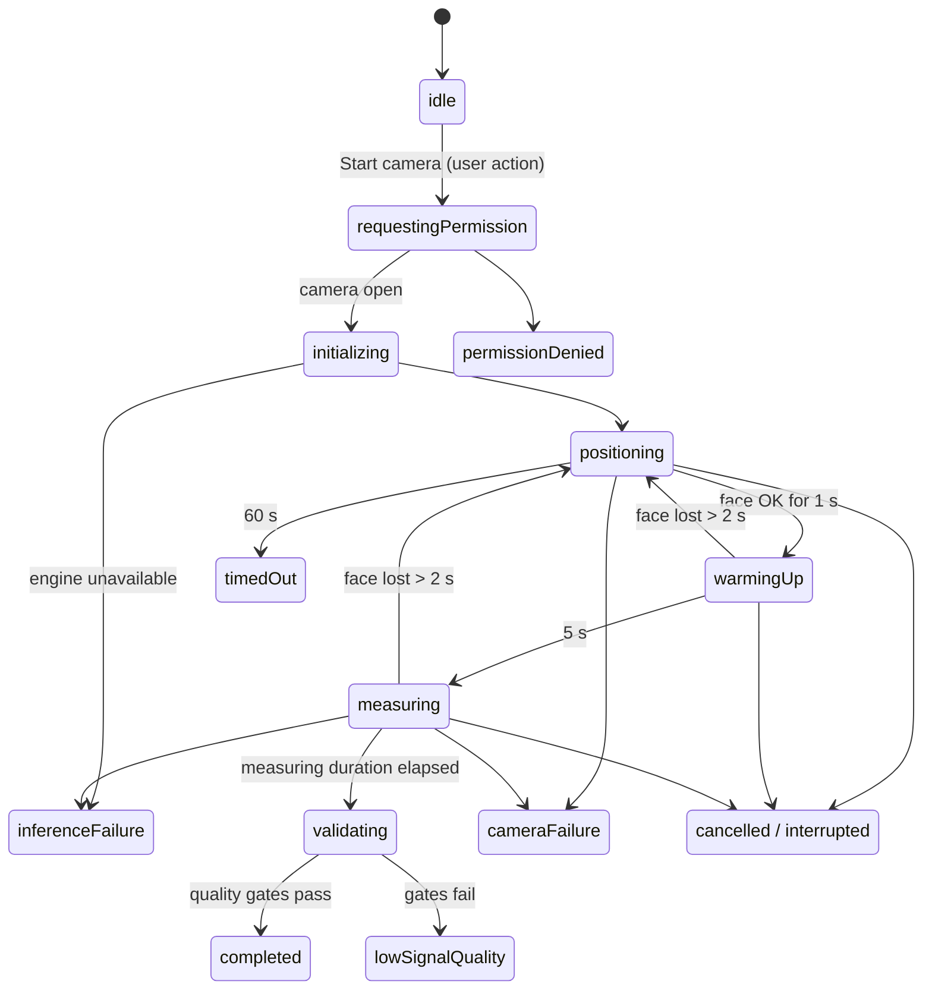
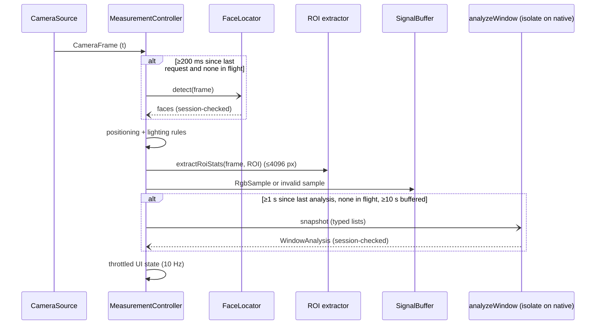

# Architecture

Feature-first Flutter app with Riverpod for dependency injection and state.
Domain logic is pure Dart (no Flutter imports) wherever possible, so it can
be unit-tested on the VM, compiled to JavaScript, and run in isolates.

## Layers



Platform adapters are chosen at startup by `PlatformServices.detect()` using
conditional imports (`dart.library.io` / `dart.library.js_interop`), and
injected through `platformServicesProvider`, so tests substitute fakes.

## Directory map

```
lib/
  main.dart                     bootstrap: DB, settings, version, error hooks
  app/                          app widget, router, providers, brand, theme
  core/
    errors/app_error.dart       typed AppError hierarchy
    logging/app_logger.dart     redacting structured logger
    platform/                   PlatformServices + io/web/stub factories
    storage/                    database open, migrations, factories
  features/
    onboarding/ home/ measurement/ results/ history/ settings/ about/
    signal_quality/domain/      quality enums, metrics, config, assessor
  services/
    camera/                     CameraFrame, CameraSource, mobile + web
    face_detection/             FaceLocator, ML Kit, guide heuristic, NV21
    frame_processing/           ROI colour statistics
    rppg/                       DSP, POS, CHROM, spectral estimator,
                                window analyzer, engines, sample buffer
    export/                     JSON/CSV builder, io/web savers
  shared/widgets/               cards, badges, charts, label mappers
  l10n/                         ARB + generated localisations
```

## Measurement session



Terminal phases may only go back to `idle` or `requestingPermission`. Every
transition goes through `MeasurementStateMachine.canTransition`; invalid ones
are rejected and logged.

### Frame pipeline (per frame, main isolate, bounded cost)



Back-pressure: the camera stream is consumed synchronously and does constant
work per frame; expensive work (face detection, window analysis) is
single-flight, so excess frames simply do not trigger new work. Nothing is
queued.

Stale-result protection: every async continuation checks that its `_Session`
object is still the current one; cancel/pause/failure replace or clear it.

## Persistence

sembast (pure Dart, JSON documents) with a version number and an ordered
migration chain (`core/storage/migrations.dart`). Upgrades run inside
sembast's `onVersionChanged` transaction. Records are parsed tolerantly;
unparseable rows are skipped and counted, never crash history.

## Why these choices

See docs/technical_decisions.md.
